# 分布式短链平台 · 架构与设计文档

> 版本 `1.0.0` ｜ 技术栈：Spring Boot 3.4.4 / Java 21 / MySQL 8.0 / Redis 7 / Kafka 3.9
> 本文所有结论均对照 `src/main/java` 实际代码，并标注了经实验验证的结论。

---

## 目录

- [1. 项目概览](#1-项目概览)
- [2. 总体架构图](#2-总体架构图)
- [3. 核心链路](#3-核心链路)
- [4. 数据模型](#4-数据模型)
- [5. Redis 设计](#5-redis-设计)
- [6. Kafka 设计](#6-kafka-设计)
- [7. 核心考点](#7-核心考点)
- [8. 已知问题与优化方向](#8-已知问题与优化方向)
- [9. 运行与验证](#9-运行与验证)

---

## 1. 项目概览

| 功能 | 实现方式 | 关键类 |
|------|----------|--------|
| 短链生成 | 雪花 ID + Base62，11 位以内短码，无需查重 | `SnowflakeIdGenerator`、`Base62`、`LinkService#create` |
| 短链跳转 | Redis 缓存 + 302 重定向，空值占位防穿透 | `RedirectController`、`LinkService#resolve` |
| 点击统计 | Redis 当日实时计数 + HyperLogLog UV；**总点击由 MySQL 日统计 `SUM` 派生**；Kafka 异步聚合落库，消费位点同事务提交（不重复计数） | `StatsService`、`ClickEventProducer`、`ClickStatsConsumer` |
| 限流 | Redis + Lua 固定窗口：创建 5 次/分、跳转 120 次/分（按 IP） | `RateLimitService` |
| 过期控制 | 创建时可指定 `expireAt`，过期后跳转返回 410 | `LinkService#resolve` |
| 可视化页面 | 单文件静态页，创建 + 统计一体化 | `static/index.html` |

**量化指标（实测）**

| 项 | 值 |
|----|-----|
| 短码长度 | 上限 11 位；2026 年时间戳对应的实际长度为 **10 位**（实测） |
| 短码唯一性 | `encode` 在 `0..2,999,999` 区间零重复（300 万样本实测，映射为单射） |
| 单机发号能力 | 4096 ID/ms（12 bit 序列），理论 409 万/秒/实例 |
| 机器号容量 | 10 bit → 1024 个实例 |
| UV 统计内存 | HyperLogLog 固定 12 KB/短链（16384 registers；稀疏编码阶段更小） |
| 统计精度 | HyperLogLog 标准误差约 0.81% |
| Topic 保留 | 7 天（`retention.ms`） |
| Redis 淘汰策略 | `volatile-lru`：所有业务 key 必须带 TTL（实测 `sl:uv:{code}` = 180 天、`sl:cnt:{code}:{date}` = 48h、`sl:link:{code}` = 24h） |

---

## 2. 总体架构图

### 2.1 分层架构

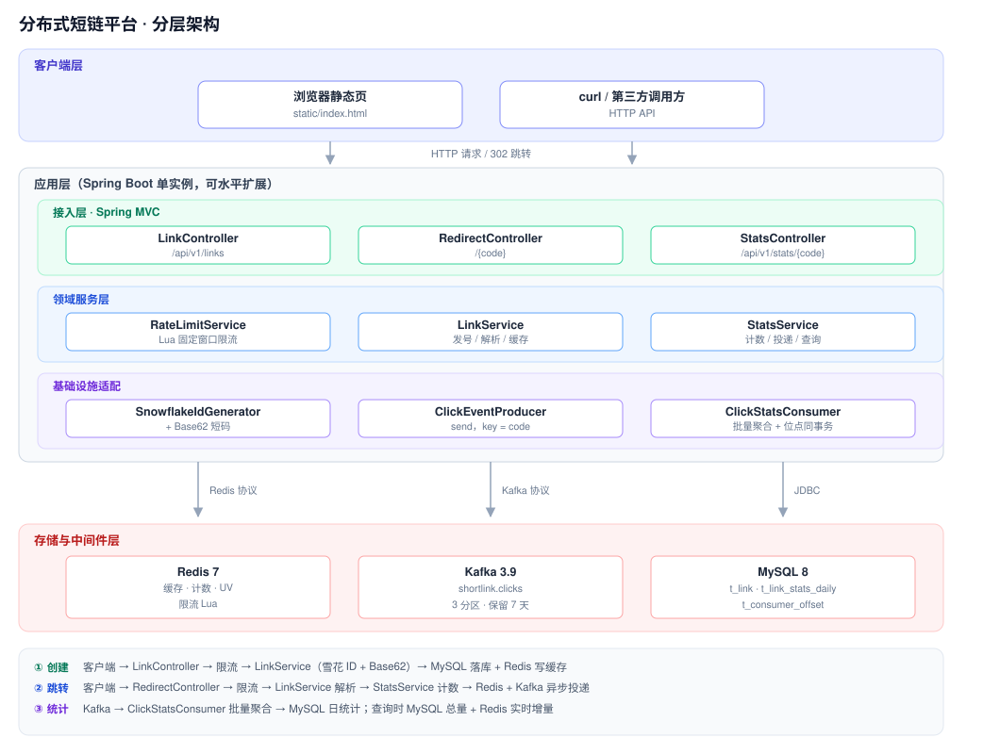

分层依赖自上而下。应用层内部再分三层：**接入层**（MVC 控制器）只做参数校验与路由，**领域服务层**承担业务逻辑，**基础设施适配**封装发号、外部中间件与 Kafka 收发。

存储层三个组件的职责边界：Redis 存「易失的实时数据」（缓存 / 当日计数 / UV / 限流），MySQL 存「必须持久化的数据」（短链映射 / 日统计 / 消费位点），Kafka 只做点击事件的异步管道。图中第 ③ 条链路是唯一的**反向数据流**——`Kafka → ClickStatsConsumer → MySQL`，消费端属于应用层但由 Kafka 驱动。

<details>
<summary>Mermaid 源码（支持 Mermaid 的渲染器可直接显示为图表）</summary>

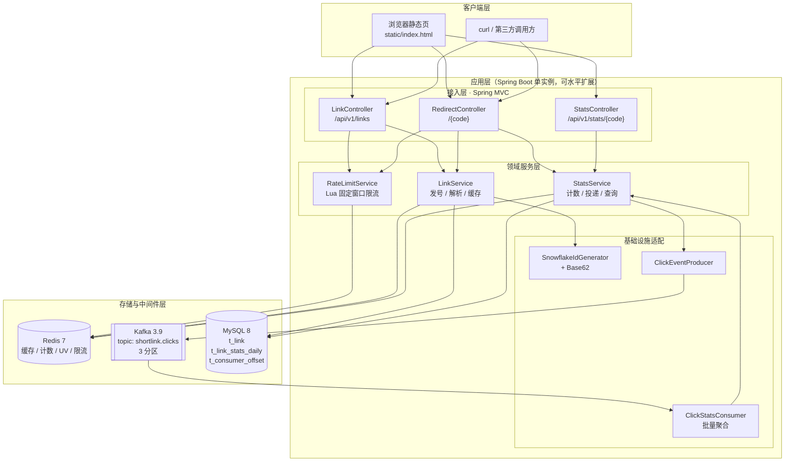

</details>

### 2.2 读写路径分离

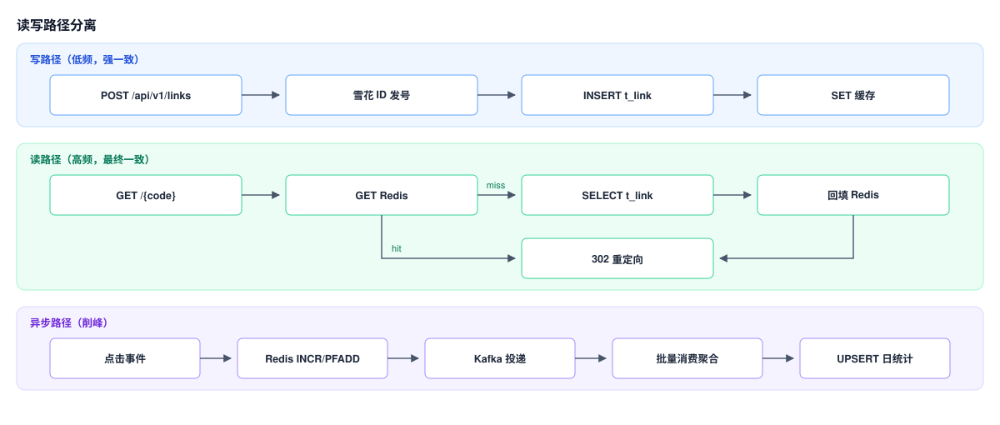

<details>
<summary>Mermaid 源码</summary>

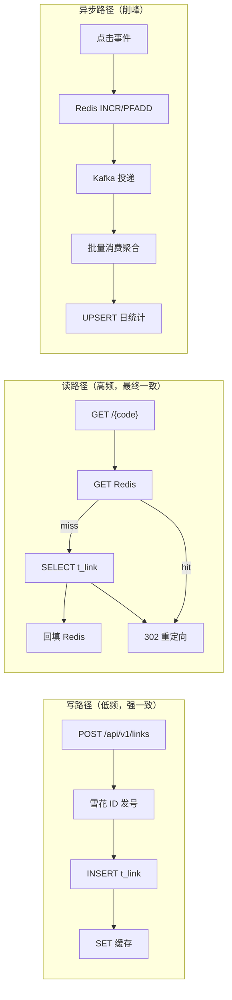

</details>

**核心思想**：跳转链路只依赖一次 Redis 读（命中时），所有统计写入都被挪出主链路——Redis 同步计数保证「查得到」，Kafka 异步落库保证「存得住」。

---

## 3. 核心链路

### 3.1 创建短链

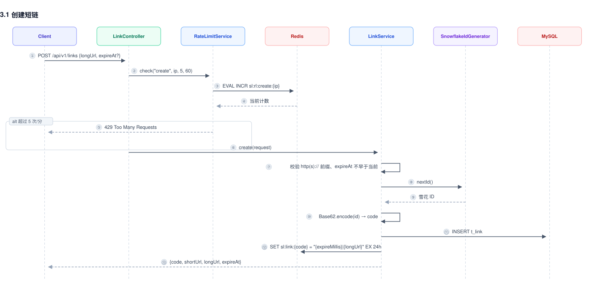

<details>
<summary>Mermaid 源码</summary>

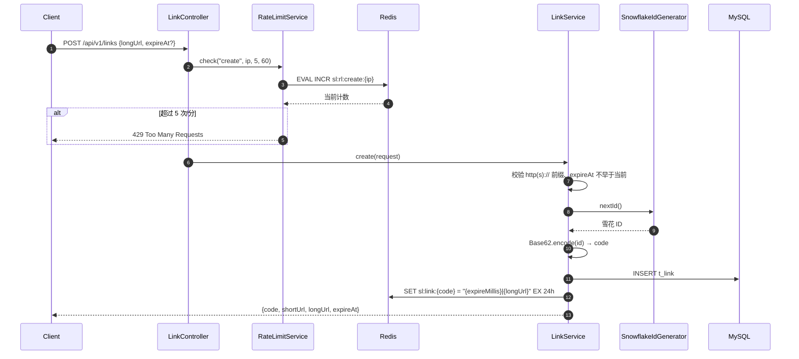

</details>

要点：**先生成 ID 再拼短码，不做查重**。因为雪花 ID 全局唯一且 Base62 是单射，短码天然无碰撞，省掉一次 `SELECT` 和潜在的重试。

### 3.2 短链跳转（读路径）

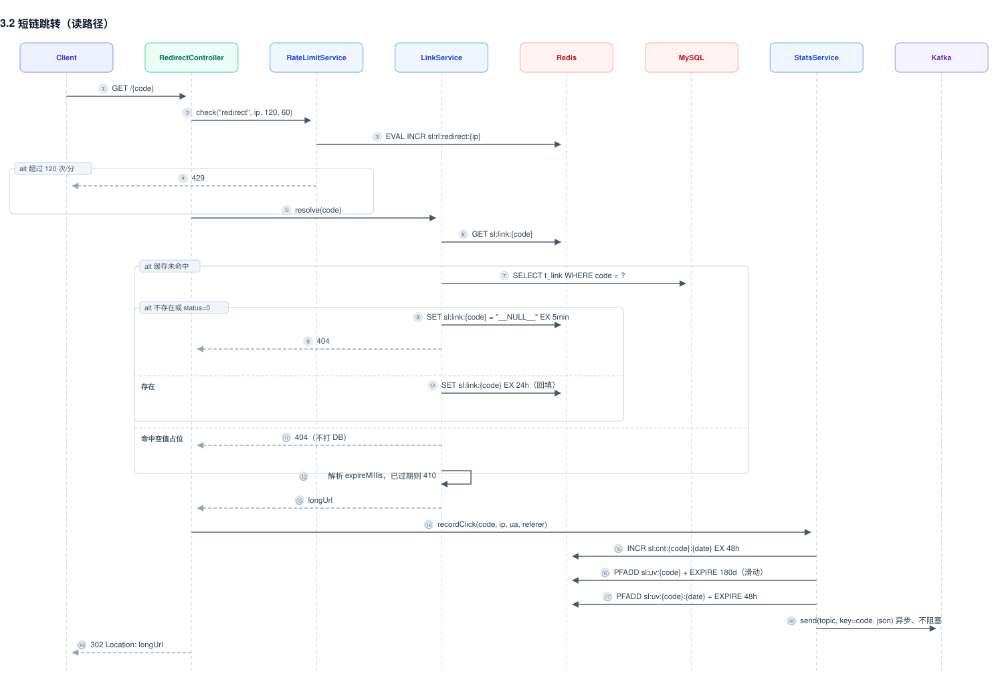

<details>
<summary>Mermaid 源码</summary>

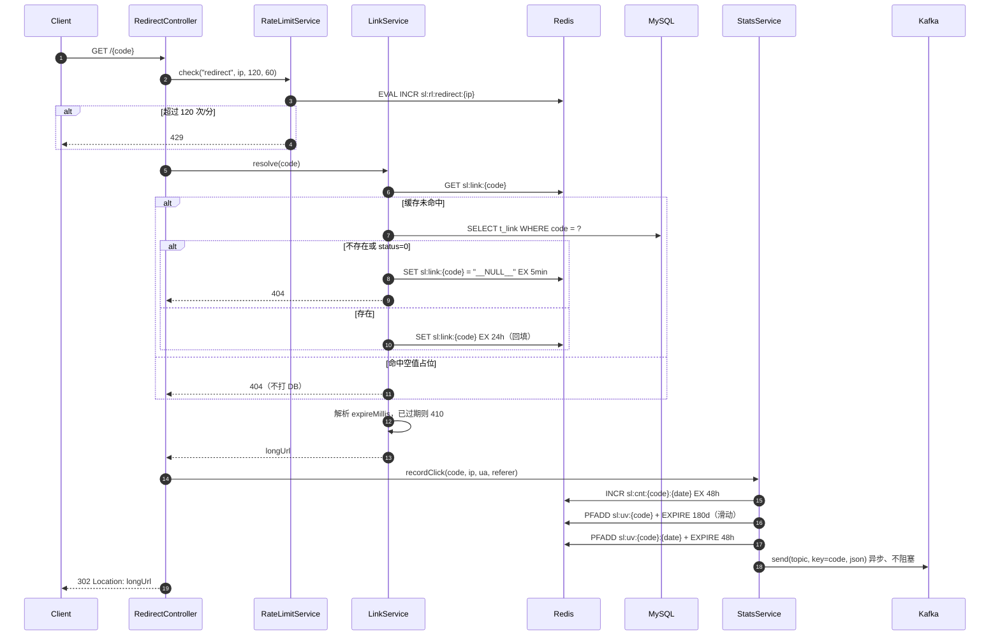

</details>

**为什么是 302 而不是 301**：301 会被浏览器**永久**缓存，用户第二次点击不再到服务端，统计会严重偏低（且无法通过服务端修正）。302 每次都会回源，代价是一次额外请求，换来统计准确。

### 3.3 点击统计聚合

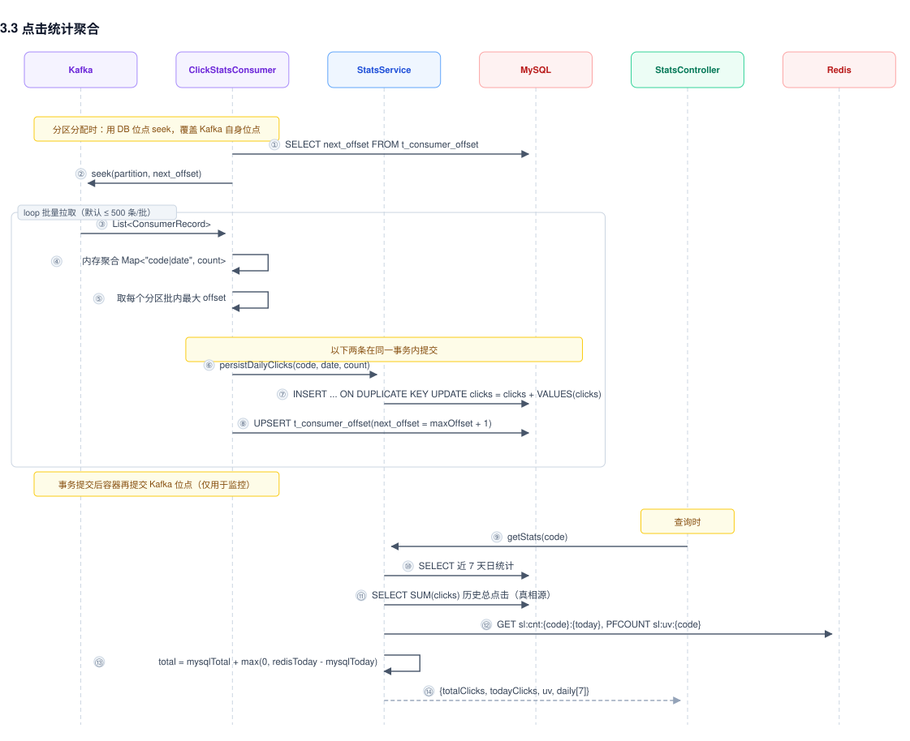

<details>
<summary>Mermaid 源码</summary>

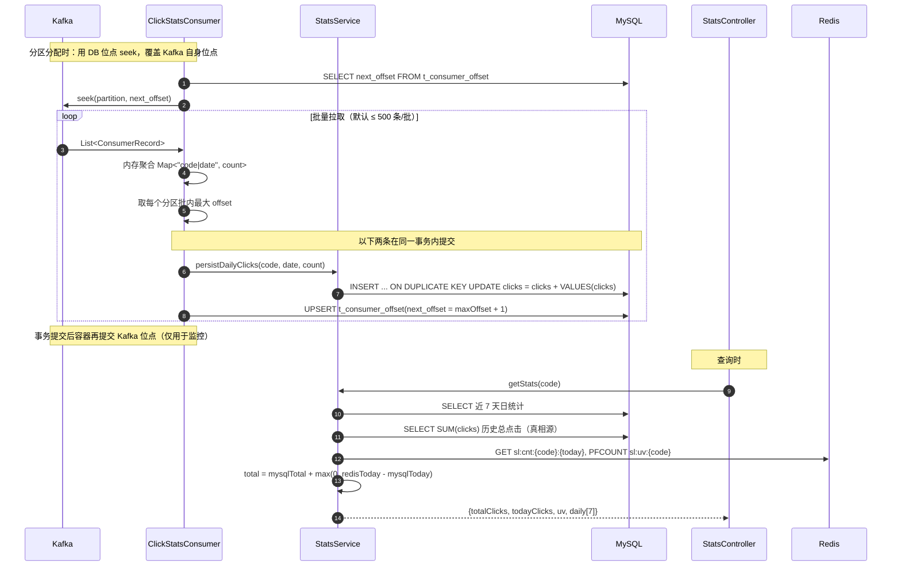

</details>

**削峰效果**：一批 M 条同一短链的点击，从「M 次 `UPDATE`」压缩为「1 次 `UPSERT`」。以 500 条/批、单短链热点场景为例，写库次数降低约 500 倍。

---

## 4. 数据模型

### 4.1 MySQL

```sql
-- 短链映射表
CREATE TABLE IF NOT EXISTS t_link (
    id         BIGINT       NOT NULL COMMENT '雪花ID，同时是短码的来源',
    code       VARCHAR(16)  NOT NULL COMMENT 'Base62 短码',
    long_url   VARCHAR(2048) NOT NULL COMMENT '原始长链接',
    status     TINYINT      NOT NULL DEFAULT 1 COMMENT '1-有效 0-禁用',
    created_at TIMESTAMP    NOT NULL DEFAULT CURRENT_TIMESTAMP,
    expire_at  DATETIME     NULL COMMENT '过期时间，NULL 表示永久',
    PRIMARY KEY (id),
    UNIQUE KEY uk_code (code),
    KEY idx_created_at (created_at)
) ENGINE = InnoDB DEFAULT CHARSET = utf8mb4 COMMENT '短链映射';

-- 点击日统计表（Kafka 消费端批量聚合写入）
CREATE TABLE IF NOT EXISTS t_link_stats_daily (
    id        BIGINT  NOT NULL AUTO_INCREMENT,
    code      VARCHAR(16) NOT NULL,
    stat_date DATE    NOT NULL,
    clicks    BIGINT  NOT NULL DEFAULT 0,
    PRIMARY KEY (id),
    UNIQUE KEY uk_code_date (code, stat_date),
    KEY idx_stat_date (stat_date)
) ENGINE = InnoDB DEFAULT CHARSET = utf8mb4 COMMENT '短链日统计';

-- Kafka 消费位点表：与统计累加「同一事务」提交，实现不重复计数
CREATE TABLE IF NOT EXISTS t_consumer_offset (
    id           BIGINT       NOT NULL AUTO_INCREMENT,
    group_id     VARCHAR(128) NOT NULL COMMENT '消费组',
    topic        VARCHAR(128) NOT NULL,
    partition_no INT          NOT NULL COMMENT '分区号',
    next_offset  BIGINT       NOT NULL COMMENT '下一条待消费位点 = 已处理位点 + 1',
    updated_at   TIMESTAMP    NOT NULL DEFAULT CURRENT_TIMESTAMP ON UPDATE CURRENT_TIMESTAMP,
    PRIMARY KEY (id),
    UNIQUE KEY uk_group_topic_partition (group_id, topic, partition_no)
) ENGINE = InnoDB DEFAULT CHARSET = utf8mb4 COMMENT 'Kafka 消费位点';
```

设计要点：

- `uk_code` 是唯一索引，既是业务约束也是跳转查询的索引；`PRIMARY KEY (id)` 用雪花 ID 而非自增，避免多实例发号依赖 DB。
- 日统计表用 `(code, stat_date)` 唯一键，使 `ON DUPLICATE KEY UPDATE` 能原子累加，避免「查-改-写」的丢失更新。
- 统计表按天聚合而非每次点击一行，行数由「点击数」降为「短链数 × 天数」。
- `t_consumer_offset` 用 `(group_id, topic, partition_no)` 唯一键，每个分区一行，行数恒为「分区数」（当前 3 行），用它替换 Kafka 自身位点作为消费进度真相源，详见 [6.5](#65-投递语义与幂等)。

### 4.2 Redis Key 全表

| Key 模式 | 类型 | 写入时机 | TTL | 用途 |
|----------|------|----------|-----|------|
| `sl:link:{code}` | String | 创建时写入；读取未命中时回填 | 24h | 短码 → `"{expireMillis}\|{longUrl}"` |
| `sl:link:{code}` | String | 查询不存在的短码时 | 5min | 值固定 `__NULL__`，空值占位防穿透 |
| `sl:cnt:{code}:{date}` | String | 每次跳转 `INCR` | 48h | 当日点击（实时查询用） |
| `sl:uv:{code}` | HyperLogLog | 每次跳转 `PFADD` + `EXPIRE` 续期 | 180 天（滑动） | 历史 UV（近似值） |
| `sl:uv:{code}:{date}` | HyperLogLog | 每次跳转 `PFADD` | 48h | 当日 UV |
| `sl:rl:{scene}:{ip}` | String | 每次请求 `INCR` | 窗口长度（首次设置） | 限流计数，`scene` ∈ {create, redirect} |

> 缓存值用 `"{expireMillis}|{longUrl}"` 单 key 存储，把「是否过期」这个判断也放进缓存，命中时**零额外查询**即可返回 410。

**两条硬性约束**（表中所有 key 都必须同时满足）：

1. **不允许存在无 TTL 的 key**。Redis 配置为 `volatile-lru`——只淘汰「带过期时间」的 key。一旦出现无 TTL 的 key，内存打满时不会再触发淘汰，而是直接**拒绝写入（OOM 错误）**，把「缓存降级」升级成「写入不可用」。
2. **不允许存在「无 TTL 且必须长期保留」的统计 key**。这类 key 在缓存定位的 Redis 里无法可靠存在：要么被淘汰（数据静默丢失），要么永不释放（内存无限增长）。因此**历史总点击不放在 Redis**，改由 MySQL 日统计 `SUM(clicks)` 得出（见 [5.2](#52-计数与-uvincr--hyperloglog)）。

---

## 5. Redis 设计

### 5.1 缓存：Cache-Aside + 空值占位

写路径采用 **Write-Through**（创建时同时写 DB 和 Redis），读路径采用 **Cache-Aside**（未命中回源 DB 并回填）。

```java
public String resolve(String code) {
    String key = cacheKey(code);
    String cached = redis.opsForValue().get(key);

    if (cached == null) {
        Link link = linkRepository.findByCode(code).orElse(null);
        if (link == null || link.getStatus() == 0) {
            redis.opsForValue().set(key, NULL_PLACEHOLDER, Duration.ofMinutes(5));
            throw new ResponseStatusException(HttpStatus.NOT_FOUND, "短链不存在: " + code);
        }
        cached = toCacheValue(link.getLongUrl(), link.getExpireAt());
        redis.opsForValue().set(key, cached, Duration.ofHours(cacheTtlHours));
    } else if (NULL_PLACEHOLDER.equals(cached)) {
        throw new ResponseStatusException(HttpStatus.NOT_FOUND, "短链不存在: " + code);
    }
    // ... 过期判断，返回 longUrl
}
```

三道防线（依次应对缓存穿透 / 击穿 / 雪崩）：

| 问题 | 本项目对策 |
|------|-----------|
| **缓存穿透**（查不存在的短码） | 写入 `__NULL__` 占位，TTL 5min；5 分钟内同一非法短码不再打 DB |
| **缓存击穿**（热点 key 失效瞬间） | 当前实现**未加互斥锁**，靠回填 TTL 24h + 热点长期驻留缓解；高并发下建议加 Redis 分布式锁或逻辑过期 |
| **缓存雪崩**（大量 key 同时失效） | TTL 固定 24h，理论上存在同时失效风险；建议改为 `24h + random(0, 1h)` 抖动 |

**空值占位与「后来才创建」的关系**：若先探测了不存在的 `code`（写入 `__NULL__`），之后该短码被创建，`LinkService#create` 会直接 `SET` 覆盖占位值，因此不会出现「已创建但 5 分钟内仍 404」的问题。

### 5.2 计数与 UV：INCR + HyperLogLog

**写入（跳转时）**：只维护「当日」实时值和 UV，每个 key 都带 TTL。

```java
// 当日点击：固定 48h TTL，只在首次 INCR 时设置
incrementWithTtl(CNT_KEY_PREFIX + code + ":" + today, Duration.ofHours(48));

// 总 UV：MySQL 未持久化 UV，只能依赖 HLL，用滑动 TTL 兜底内存增长
redis.opsForHyperLogLog().add(UV_KEY_PREFIX + code, ip);
redis.expire(UV_KEY_PREFIX + code, UV_TOTAL_TTL);      // 180 天，每次点击续期

// 当日 UV
redis.opsForHyperLogLog().add(UV_KEY_PREFIX + code + ":" + today, ip);
redis.expire(UV_KEY_PREFIX + code + ":" + today, Duration.ofHours(48));
```

**读取（统计查询）**：总量查 DB，实时值查 Redis，两者做增量补偿。

```java
long mysqlTotal = statsRepository.sumClicksByCode(code);   // 历史总点击 = 真相源
long mysqlToday = ...;                                     // 今日已落库部分
long redisToday = longValue(redis.opsForValue().get(CNT_KEY_PREFIX + code + ":" + today));

long todayClicks = Math.max(redisToday, mysqlToday);                  // Redis 丢失则回退 DB
long totalClicks = mysqlTotal + Math.max(0L, redisToday - mysqlToday); // 补上 Kafka 未落库的增量
```

- **`INCR` 而非 `GET` + `SET`**：Redis 单线程执行、命令原子，天然不会丢失更新，省掉分布式锁。
- **`INCR` + 首次设 TTL 的写法**：只有返回值等于 1 时才 `EXPIRE`。若每次 `INCR` 都续期，key 将永远不过期；若先 `SET` 再 `INCR` 会多一次往返。
- **总点击为什么放 MySQL 而不是 Redis**：这是本项目最容易踩的坑。早期实现把总量累加在 `sl:cnt:{code}` 上，但该 key **没有 TTL**，而 Redis 配置的是 `allkeys-lru`——内存压力下它会被当作普通缓存键**淘汰**，`totalClicks` 于是从「几万」突降到 0，且无法从 Redis 侧察觉。修正后有两点变化：① `maxmemory-policy` 改为 `volatile-lru`（只淘汰带 TTL 的 key）；② 总量改由 MySQL `SUM(clicks)` 得出——DB 本来就是日统计的持久化落点，总量有界、精确、不受缓存淘汰影响。
- **增量补偿的由来**：`mysqlTotal` 已包含今日**已落库**的部分，而 Kafka 落库有秒级延迟。用 `redisToday - mysqlToday` 补上「已发生但还没落库」的差额，保证「总点击」不会短暂小于「今日点击」。取 `max(0, …)` 是为了在重复消费导致 `mysqlToday > redisToday` 时不产生负补偿。
- **UV 用 HyperLogLog 而非 Set**：Set 存全量 IP，100 万 UV 约需几十 MB；HLL 固定 **12 KB**（稀疏编码下更小），代价是约 0.81% 的统计误差。UV 是「趋势指标」而非「精确报表」，这个取舍是划算的。
- **UV 的滑动 TTL**：`sl:uv:{code}` 每次点击续期 180 天，有流量就保活，长期无流量的短链自动随 LRU / 过期释放内存。代价是**冷短链的 UV 会被重置**——因为 UV 的唯一数据源就是 Redis（MySQL 未持久化 UV），这是当前架构的既有限制，见 [第 8 节](#8-已知问题与优化方向)。
- **TTL 是硬约束**：在 `volatile-lru` 下，「无 TTL 且必须长期保留」的 key 是不可调和的矛盾——要么被淘汰（数据静默丢失），要么永不释放（内存无限增长）。遇到这类需求，正确做法是**把它挪到持久化存储**，而不是留在 Redis 里。
- **实时性**：今日点击与 UV 走 Redis，跳转后立即可查；总点击与日统计明细走 Kafka → MySQL，延迟数秒。

### 5.3 限流：INCR + EXPIRE 的 Lua 原子化

```lua
local current = redis.call('INCR', KEYS[1])
if current == 1 then
    redis.call('EXPIRE', KEYS[1], ARGV[1])   -- ARGV[1] = 窗口秒数
end
if current > tonumber(ARGV[2]) then          -- ARGV[2] = 限流阈值
    return 0
end
return 1
```

**为什么必须用 Lua**：`INCR` 和 `EXPIRE` 两条命令若分开发送，存在两类竞态——① 两个请求都 `INCR` 得到 1，都去 `EXPIRE`，重复设置无害；② 更严重的是进程在 `INCR` 后、`EXPIRE` 前崩溃，key 将**永不过期**，该 IP 被永久限流。放进单个 Lua 脚本后，Redis 单线程原子执行整个脚本，上述窗口都不存在。

**`RateLimitService#check` 的两个细节**：

- key 为 `sl:rl:{scene}:{identity}`，`scene` 隔离创建与跳转两套配额，互不干扰。
- 被限流的请求**仍会 `INCR`**（脚本先自增再判断），但由于 `EXPIRE` 只在首次设置，窗口边界不会被恶意请求无限延长，窗口一到即恢复。

**IP 取值**：`WebUtils#clientIp` 优先取 `X-Forwarded-For` 第一个 IP，兼容反向代理；但该头可被客户端伪造，生产环境需由可信网关覆写。

---

## 6. Kafka 设计

### 6.1 Topic 定义

```java
@Bean
public NewTopic clicksTopic(@Value("${shortlink.topic.clicks}") String name) {
    return TopicBuilder.name(name)
            .partitions(3)
            .replicas(1)
            .config(TopicConfig.RETENTION_MS_CONFIG, String.valueOf(7L * 24 * 3600 * 1000))
            .build();
}
```

| 配置 | 值 | 理由 |
|------|-----|------|
| `partitions` | 3 | 并发消费上限 = 分区数；3 分区允许最多 3 个消费实例并行 |
| `replicas` | 1 | 单机演示环境；生产至少 3，配合 `min.insync.replicas=2` |
| `retention.ms` | 7 天 | 统计事件过期即无价值；也留出故障后重放窗口 |

### 6.2 消息体

```java
public record ClickEvent(
        String code,      // 短码，同时作为分区 key
        long timestamp,   // 点击时间戳
        String ip,        // 客户端 IP（UV 去重依据）
        String userAgent, // UA（终端分析）
        String referer,   // 来源页（渠道分析）
        String date       // 点击日（yyyy-MM-dd），由生产端固化，避免消费端跨天歧义
) {}
```

`date` 由**生产端**填入而非消费端计算，这一点很关键：消费端可能因积压延迟到次日才处理，若在消费端取 `LocalDate.now()`，前一天 23:59 的点击会被错记到第二天。

### 6.3 生产端

```java
public void send(ClickEvent event) {
    try {
        String json = objectMapper.writeValueAsString(event);
        kafkaTemplate.send(topic, event.code(), json)
                .whenComplete((result, ex) -> {
                    if (ex != null) {
                        logger.warn("[ClickProducer] send failed: code={} err={}", event.code(), ex.getMessage());
                    }
                });
    } catch (Exception e) {
        // 统计丢失可容忍，不能影响跳转
        logger.warn("[ClickProducer] serialize failed: {}", e.getMessage());
    }
}
```

| 决策 | 说明 |
|------|------|
| **key = `code`** | 同一短链的事件落到同一分区，**保证单短链事件有序**；同时让「同一 code 的点击」聚集，便于批量聚合成一行 |
| **`send` 异步 + 回调** | 返回 `CompletableFuture`，回调只记日志。跳转延迟与 Kafka 无关，Kafka 抖动不会拖慢 302 |
| **异常吞掉不抛出** | 统计是「尽力而为」；绝不能因为统计失败导致用户跳转失败 |
| **`acks=all` + `retries=3`** | 保证不丢；本项目 `kafka-clients` 实测为 **3.8.1**（`spring-kafka` 3.3.4），≥ 3.0 即默认 `enable.idempotence=true`（KIP-679），生产者重试不会产生重复消息 |
| **value 用 JSON 字符串** | 可读、易排障、跨语言；代价是比 Avro/Protobuf 体积大。量大后可换 Schema Registry |

### 6.4 消费端与削峰

```java
@KafkaListener(topics = "${shortlink.topic.clicks}")
public void onBatch(List<ConsumerRecord<String, String>> records) {
    Map<String, long[]> agg = new HashMap<>();
    Map<TopicPartition, Long> maxOffsets = new HashMap<>();
    for (ConsumerRecord<String, String> record : records) {
        ClickEvent event = statsService.parseEvent(record.value());
        if (event != null) {                               // 脏消息跳过，不阻塞整批
            agg.computeIfAbsent(event.code() + "|" + event.date(), k -> new long[2])[0] += 1;
        }
        // 脏消息不计入统计，但位点仍要推进，否则会卡住整个分区
        maxOffsets.merge(new TopicPartition(record.topic(), record.partition()),
                record.offset(), Math::max);
    }
    // 一个事务内：累加统计 + 推进位点（详见 6.5）
    transactionTemplate.executeWithoutResult(status -> {
        agg.forEach((key, count) -> {
            String[] parts = key.split("\\|", 2);
            statsService.persistDailyClicks(parts[0], LocalDate.parse(parts[1]), count[0]);
        });
        maxOffsets.forEach((tp, off) ->
                offsetRepository.upsertOffset(groupId, tp.topic(), tp.partition(), off + 1));
    });
}
```

配置：`listener.type=batch`、`group-id=shortlink-stats`、`auto-offset-reset=latest`。

| 关键点 | 说明 |
|--------|------|
| **批量监听** | 一次 `poll` 拿一批（默认 ≤ 500 条），在**内存中按 `(code, date)` 聚合**后再落库 |
| **写库放大倍率** | 一批内同短链 M 次点击 → 1 次 `UPSERT`，写库次数降为原来的 `1/M` |
| **`ON DUPLICATE KEY UPDATE clicks = clicks + VALUES(clicks)`** | 在 DB 侧做原子累加，多个消费线程/实例并发写同一 `(code, date)` 也不会丢失更新 |
| **脏消息隔离** | `parseEvent` 失败返回 `null` 并跳过，单条坏消息不会让整批反复重试卡死 |
| **位点与数据同事务** | 同一事务提交「统计累加 + 位点推进」，使重放不再导致重复计数。见 [6.5](#65-投递语义与幂等) |
| **`auto-offset-reset=latest`** | 新消费组从最新位点开始，避免上线时重放历史事件造成统计暴涨；**首次启动**位点表为空时才依赖它 |

### 6.5 投递语义与幂等

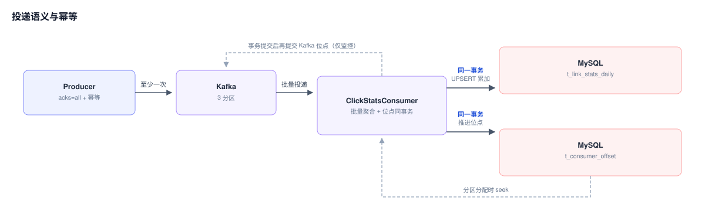

<details>
<summary>Mermaid 源码</summary>

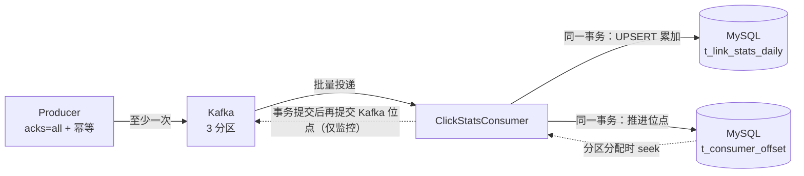

</details>

#### 问题：位点提交与写库之间存在窗口

用 `AckMode.BATCH` 时顺序是「写库 → 提交位点」，两者之间必然有窗口：

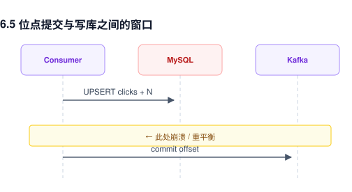

<details>
<summary>Mermaid 源码</summary>

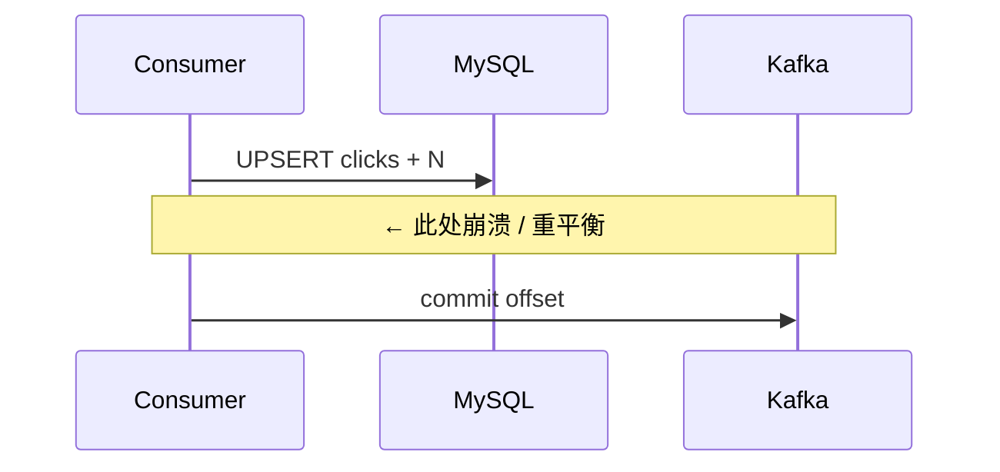

</details>

崩溃后重启，位点仍停在批次之前 → **整批重放**。而 `clicks = clicks + VALUES(clicks)` 是累加语义、非幂等，重放即重复计数。

#### 解法：位点与数据在同一个事务里提交

把「消费进度」也落到 MySQL，与业务数据同事务写入：

```java
transactionTemplate.executeWithoutResult(status -> {
    agg.forEach((key, count) -> statsService.persistDailyClicks(...));            // 业务数据
    maxOffsets.forEach((tp, off) -> offsetRepository.upsertOffset(..., off + 1)); // 消费位点
});
```

- 事务提交 → 数据与位点一起生效，位点已越过该批次，不会被重放；
- 事务回滚 → 数据与位点一起撤销，下次从原位点重来，也不会残留半批数据。

再配合分区分配时**用 DB 位点覆盖 Kafka 位点**，即使 Kafka 侧位点被回退也不会真的重放：

```java
// ClickStatsConsumer implements ConsumerSeekAware
public void onPartitionsAssigned(Map<TopicPartition, Long> assignments, ConsumerSeekCallback callback) {
    assignments.keySet().forEach(tp -> offsetRepository
            .findByGroupIdAndTopicAndPartitionNo(groupId, tp.topic(), tp.partition())
            .ifPresent(stored -> callback.seek(tp.topic(), tp.partition(), stored.getNextOffset())));
}
```

#### 为什么不用「eventId + 去重表」

那套方案要为每条消息写一行去重记录，会把 [6.4](#64-消费端与削峰) 的批量聚合优势吃掉——写库次数从「每批 1 行」退化为「每条消息 1 行」，还要额外处理去重表的归档清理。位点方案每批只多写「分区数」行（当前 3 行）且行数恒定。

#### 语义对照

| 环节 | 语义 | 说明 |
|------|------|------|
| 生产者 | 至少一次 | `acks=all` + `kafka-clients` 3.8.1 默认幂等（KIP-679），重试不产生重复 |
| 消费者 | **有效一次** | 事务提交点即「已处理」边界；Kafka 自身位点退化为监控用途，不再是正确性依据 |

实测验证见 [8.1](#81-已修复)。

#### 已知取舍：空闲分区的「假 lag」

seek 之后若没有新消息，监听器不会被调用，容器也就不会提交位点——broker 侧 `CURRENT-OFFSET` 会停在被回退的位置，`LAG` 显示虚高值。该分区**下一条消息到达并处理完后**，位点会直接跳到日志末端、lag 归零（实测 partition 2 由 `CURRENT-OFFSET=0 / LAG=24` 变为 `24 / 0`）。

- 只影响监控展示，**不影响正确性**；
- 生产上应基于 `t_consumer_offset` 而非 Kafka 提交位点计算滞后；
- 若必须让 broker 位点也实时对齐，可在 seek 后改用 `ConsumerAwareRebalanceListener` 拿到 `Consumer` 直接 `commitSync`。

---

## 7. 核心考点

> 按「面试官会怎么问 → 本项目怎么做 → 追问点」组织。

### 7.1 Redis 相关

**① 为什么用 Redis 做短链跳转的缓存？**

跳转是典型的**读多写少、超高 QPS** 场景。一次 MySQL 查询约 ms 级，Redis 约 0.1ms 级，且短链 URL 小而热，天然适合缓存。项目的读路径设计成「一次 Redis GET 命中即 302」，把 DB 完全挡在热点路径之外。

**追问**：Redis 挂了怎么办？→ 当前实现会直接抛异常导致 500。生产做法是降级回源 DB（加熔断/限流保护），但要注意**不能用空值兜底返回错误页**，否则等于全站 404。

**② 缓存穿透、击穿、雪崩分别怎么解决？**

| 问题 | 特征 | 本项目实现 | 更深一层 |
|------|------|-----------|---------|
| 穿透 | 查询**不存在**的数据，缓存永不命中 | 写 `__NULL__` 占位，TTL 5min | 更完备的是布隆过滤器（可挡在 Redis 之前，但需处理删除）；或参数合法性前置校验 |
| 击穿 | **热点 key 失效瞬间**大量并发回源 | 未实现互斥，靠长 TTL 缓解 | 分布式锁（`SETNX`）或「逻辑过期 + 异步重建」 |
| 雪崩 | **大量 key 同时失效** | 未实现，TTL 统一 24h | TTL 加随机抖动；Redis 集群 + 多级缓存（Caffeine + Redis） |

**关键认知**：空值占位的 TTL 要**短**（这里 5min）。太短挡不住攻击，太长会让「误判」持续过久。项目里 `create` 会覆盖占位值，所以不存在「创建后仍 404」的问题。

**③ `INCR` 计数为什么不需要加锁？**

Redis 命令在单线程模型中原子执行。若用「`GET` 读值 → 应用层 +1 → `SET` 写回」，两个并发请求会丢失更新（经典 read-modify-write 竞态）。`INCR` 把这三步压成一条原子命令，因此无需分布式锁。

**④ UV 为什么用 HyperLogLog？误差能不能接受？**

- Set 方案：内存 = O(UV)，100 万 UV 约 MB 级，且随短链数线性增长。
- HLL 方案：**固定 12 KB**，标准误差约 **0.81%**。

UV 是运营趋势指标（「这周涨了多少」），不是财务对账数据，0.81% 误差完全可接受。若真需要精确 UV，则要用 Set 或 Bitmap（按 IP 哈希分桶，内存换精度）。

**追问一**：HLL 只有 `PFADD`/`PFCOUNT`，**不能删除单个元素**——如果需要「按天滚动」的 UV，正确做法是每天一个独立 key（本项目正是 `sl:uv:{code}:{date}` + TTL 48h），而不是往同一个 key 里塞。

**追问二**：`sl:uv:{code}`（总 UV）能不能也不设 TTL？→ 不能。见 [5.2](#52-计数与-uvincr--hyperloglog)：在 `volatile-lru` 下，无 TTL 的 key **不会被淘汰**，内存打满时 Redis 会直接拒绝写入，把「缓存降级」变成「写入不可用」。所以总 UV 采用 180 天**滑动 TTL**：有流量就保活，冷短链自动释放。代价是冷短链的 UV 会被重置——因为 UV 的唯一数据源就是 Redis，见 [第 8 节](#8-已知问题与优化方向)。

**追问三**：那「总点击」为什么不学 UV 也放在 Redis？→ 因为总点击**在 MySQL 里有等价真相源**（日统计表可以 `SUM`），没必要在易失的缓存里再维护一份。这也是判断「某个数据该不该放缓存」的通用标准：**能持久化的就别只存缓存**。

**⑤ 限流为什么要用 Lua 脚本？**

`INCR` 与 `EXPIRE` 必须原子。分开执行时，若在两条命令之间发生进程崩溃/网络中断，key 已自增但没有过期时间 → **该 IP 被永久限流**（这也是你之前遇到的线上事故典型形态）。Lua 脚本在 Redis 中单线程原子执行，杜绝了这个中间态。

**追问**：固定窗口的缺陷？→ 窗口临界处可能放行近 2 倍流量（前一窗口末尾 + 后一窗口开头）。升级方案：滑动窗口（ZSET 或 Redis 7 的 `EXPIRE`/分桶计数）、令牌桶（Lua 实现）、或直接用 Sentinel/Redisson 的 `RRateLimiter`。

**⑥ 缓存与数据库的一致性怎么保证？**

本项目是「写时写 DB + 写缓存（Write-Through），读时 Cache-Aside」。风险点在于：

- **禁用短链（`status=0`）后缓存未失效**：`resolve` 只在缓存未命中时才查 DB，所以禁用的短链最长 24h 内仍可跳转。正确做法是禁用时**主动删缓存**（`DEL`），或引入 Canal/binlog 订阅做缓存失效。
- **先删缓存还是先写库**：业界共识是「先写库，再删缓存」（Cache-Aside 变体），并配合延迟双删或订阅 binlog 兜底。

**追问**：为什么不更新缓存而是删除？→ 并发写场景下更新缓存容易产生「旧值覆盖新值」；删除让下次读自然回源，虽然多一次 miss，但一致性更好。

### 7.2 Kafka 相关

**⑦ 为什么要把点击统计异步化？**

统计是**可延迟、可容忍丢失**的旁路逻辑，而跳转是**用户可感知**的关键路径。如果同步写统计表，一次跳转就要多一次 DB 写，QPS 上限直接腰斩，且统计抖动会拖慢跳转。Kafka 把这两者解耦：跳转只做「投递」，耗时与统计无关。

**⑧ 削峰是怎么实现的？**

3 层削减：

1. **Redis 同步计数**先兜住「实时可查」的需求，写内存 O(1)，不碰 DB。
2. **Kafka 缓冲**把瞬时洪峰变成匀速消费，DB 面对的是稳定速率而非脉冲。
3. **批量聚合**把 M 条同短链事件合并成 1 次 `UPSERT`，写库次数降为 `1/M`。

**⑨ 为什么 key 用 `code` 而不是随机/轮询？**

两个目的：

- **有序性**：Kafka 只保证**分区内**有序。key 相同 → 分区相同 → 同一短链的点击事件按发生顺序处理，避免统计「乱序累加」带来的中间态异常。
- **聚合友好**：同短链事件天然聚在同一批里，内存聚合才能高效命中同一个 `Map` entry。

**追问**：key 用 `code` 会不会导致**数据倾斜**？→ 会。超级热点短链会把单个分区打满。这是刻意的权衡（换有序与聚合），若要打散可加盐分桶（`code + random(0,N)`），代价是放弃单短链有序。

**⑩ 分区数和消费并发怎么配？**

- **并发上限 = 分区数**。当前 3 分区，最多 3 个消费实例有效并行；第 4 个实例会**空转**（拿不到分区）。
- 扩容分区数会**改变 key → 分区的映射**，导致同一 key 的历史与新消息落到不同分区，有序性被破坏。所以分区数应在业务初期就规划好。
- 若消费能力不足，优先考虑**增加分区 + 增加实例**，或提升批量大小 / 减少每条消息处理成本。

**⑪ 消费者重启会不会丢数据或重复？**

- **不丢**：位点提交发生在整批处理完成之后；崩溃时未提交，重启后从上次位点重放。
- **天然语义是至少一次**：因为「写库成功」和「提交位点」之间存在窗口，重启/重平衡后可能重放已处理的事件。
- **但重放不等于重复计数**：`UPSERT` 是 `clicks + VALUES(clicks)`（**加法、非幂等**），所以关键在于「重放时能不能识别出这批已经处理过」。本项目用「位点与数据同事务」解决了这点，见 [6.5](#65-投递语义与幂等)。

**⑫ 怎么做到精确一次（exactly-once）或至少幂等？**

三种主流方案的取舍：

| 方案 | 做法 | 代价 |
|------|------|------|
| **位点与数据同事务**（本项目） | 把消费位点存进 MySQL，与业务写库在同一事务提交；分区分配时用 DB 位点 seek 覆盖 Kafka 位点 | 引入一张位点表；跨系统的「位点真相源」从 Kafka 变成 DB，监控需相应调整 |
| **业务幂等 / 去重表** | 每条消息带唯一 `eventId`，建 `t_click_event(event_id)` 唯一表先插入去重再累加 | 每条消息 1 行去重记录，**吃掉了批量聚合的写库削减**；还需清理归档 |
| **Kafka 事务 + `read_committed`** | 用 Kafka 事务把「消费-处理-生产」串成原子操作，`isolation.level=read_committed` | 只适用于「消费后再生产到 Kafka」的场景；**写 MySQL 无法纳入 Kafka 事务**，仍需 `ChainedKafkaTransactionManager` 之类的两阶段协调 |
| 接受近似 | 直接接受至少一次的少量偏差 | 统计偏高且不可自愈 |

本项目选第一种：统计总量已由 `SUM(clicks)` 派生，重复消费会直接抬高总量，因此必须消除；而位点方案每批只多写「分区数」行，完全保留了批量聚合的削峰效果。

**追问**：这个方案能保证「精确一次」吗？→ 严格说是 **effectively-once（有效一次）**：事务提交点就是「已处理」的边界，回滚则整体撤销，所以既不会丢也不会重。它不依赖 Kafka 事务，也不需要业务去重表。残留风险是跨系统的一致性——若 DB 被回滚到较早的备份点而 Kafka 位点未同步回退，位点表会与数据不一致，这属于任何跨系统方案都存在的边界。

**⑬ `date` 字段为什么由生产端填？**

消费端可能因积压延迟到次日处理。若在消费端取 `LocalDate.now()`，前一天 23:59:59 的点击会被记到第二天，导致日统计错位。由生产端（跳转发生的真实时刻）固化日期，消费端只做聚合。

**⑭ `auto-offset-reset` 该怎么选？**

- `latest`（本项目）：新消费组从最新位点开始，**上线时不重放历史**，避免统计暴涨。
- `earliest`：从头消费，适合「全量重算」场景（如新增统计维度需要历史数据）。
- 注意：该配置**只在找不到已提交位点时生效**，不能用来「重置」已有位点（重置要用 `kafka-consumer-groups.sh --reset-offsets`）。

**⑮ Kafka 消息丢了怎么排查？**

从生产者到消费者的链路逐段确认：

1. 生产者 `acks=all` 是否生效、回调里是否吞异常（本项目**故意吞掉**，只打 warn，需靠日志告警兜底）。
2. Topic 是否存在、分区数是否够、`retention.ms` 是否过短导致未消费就被删。
3. 消费端是否因**脏消息**反复抛异常、位点卡住（本项目用 `parseEvent` 返回 `null` 跳过做了防护）。
4. `max.poll.interval.ms` 是否被超长处理时间击穿，导致 rebalance 循环。
5. **注意「位点真相源」已经变了**：消费进度以 MySQL 的 `t_consumer_offset` 为准，而非 Kafka 提交位点——所以空闲分区在 `kafka-consumer-groups --describe` 里的 `LAG` 会虚高（见 [6.5](#65-投递语义与幂等)）。排查「到底消费到哪了」应查 `SELECT partition_no, next_offset FROM t_consumer_offset`。

### 7.3 综合 / 系统设计

**⑯ 短码怎么生成？为什么不查重？**

雪花 ID（64 bit）→ Base62 → 11 位以内短码。

- **雪花 ID**：`1bit 符号 | 41bit 时间戳 | 10bit 机器号 | 12bit 序列`，趋势递增，DB 主键友好，多实例靠 `SHORTLINK_WORKER_ID` 区分。
- **不查重**：ID 全局唯一 + Base62 是单射 → 短码必然唯一，省掉一次 `SELECT` 和碰撞重试。**实测在 300 万个连续 ID 上零重复**。
- **代价**：短码依赖机器号分配（1024 个上限），运维上必须保证 `workerId` 唯一，否则同毫秒同序列会撞码。

**⑰ 时钟回拨怎么处理？**

`SnowflakeIdGenerator#nextId` 的策略是**等待追平**：`timestamp < lastTimestamp` 时把时间戳钳到 `lastTimestamp`，然后用 `sequence` 继续发号；若序列耗尽则自旋等待真实时钟追上：

```java
if (timestamp < lastTimestamp) {
    timestamp = lastTimestamp;   // 钳制，避免发出更小的 ID
}
// ... 序列耗尽时
while ((timestamp = System.currentTimeMillis()) <= lastTimestamp) {
    Thread.onSpinWait();
}
```

三种主流策略对比：**抛异常**（最安全，业务需重试）、**等待追平**（本项目，会阻塞线程）、**用备用位/逻辑时钟**（如百度 UID 借用未来时间戳）。回拨幅度大时「等待追平」可能长时间阻塞，生产建议改为「小回拨等待、大回拨直接抛异常」。

**⑱ 为什么 302 而不是 301？**

301 被浏览器**永久缓存**，后续点击不再到达服务端 → 统计系统性偏低，而且**无法从服务端修正**（客户端根本不再请求）。302 每次回源，牺牲一点性能换统计准确性。这也是短链服务几乎不用 301 的原因。

**⑲ Base62 的字符集与长度怎么算的？**

字符集 `0-9a-zA-Z` 共 62 个。`62^10 ≈ 8.4×10^17`，`62^11 ≈ 5.2×10^19 > 2^63 ≈ 9.2×10^18`，所以 64 bit 雪花 ID 最多需要 **11 位**；2026 年的时间戳对应实际长度 **10 位**（实测）。

⚠️ **实现细节提醒**：`Base62.encode` 是**低位在前**（`sb.append(ALPHABET[value % BASE])` 后才 `value /= BASE`），因此 `decode(encode(x)) != x`——实测 `62 → "01" → 1`、`123 → "Z1" → 3783`。短码只当作**不透明标识**使用（生成后直接入库查询，从不反解），所以唯一性和功能都不受影响；但 `decode` 方法**不可用于还原 ID**，详见 [第 8 节](#8-已知问题与优化方向)。

**⑳ 一个完整的短链请求要走几次网络往返？**

- **跳转（缓存命中）**：限流 1 次 EVAL + 缓存 1 次 GET + 计数 1 次 INCR + UV 2 次 PFADD + UV 2 次 EXPIRE ≈ **7 次 Redis 往返**，1 次响应。
- **创建**：限流 1 + DB 1（INSERT）+ 缓存 1（SET）。
- **统计查询**：Redis 2 次（GET 当日计数 / PFCOUNT UV）+ DB **3 次**（存在性校验 + 近 7 天明细 + 总量 `SUM`）。

优化方向：跳转链路的计数部分共 5 条命令，可用 **Pipeline 合并为 1 次往返**（省 4 次 RTT）；或把 `INCR` 与 `PFADD` 合并进一个 Lua 脚本，进一步降低 RTT。

---

## 8. 已知问题与优化方向

### 8.1 已修复

| 问题 | 原实现 | 修复 |
|------|--------|------|
| **统计总量依赖无 TTL 的 Redis key**，被 LRU 淘汰后 `totalClicks` 静默归零 | `sl:cnt:{code}` 无 TTL；Redis `--maxmemory-policy allkeys-lru` | ① `maxmemory-policy` 改为 `volatile-lru`（只淘汰带 TTL 的 key）；② 总点击改由 MySQL `SUM(clicks)` 得出，Redis 仅保留当日计数（48h）+ 总 UV（180 天滑动 TTL） |
| **`expireAt` 时区偏移 8 小时** | `LinkService#toCacheValue` 用 `expireAt.toInstant(ZoneOffset.UTC)`，把本地墙上时间按 UTC 解释，与 `System.currentTimeMillis()` 比较后短链晚 8 小时过期 | 改为 `expireAt.atZone(ZoneId.systemDefault()).toInstant()` |
| **消费端非幂等**：崩溃/重平衡导致整批重放，累加型 UPSERT 即重复计数 | 仅依赖 Kafka 自身位点（`AckMode.BATCH`），「写库」与「提交位点」之间存在窗口 | 新增 `t_consumer_offset` 表，把消费位点与业务数据放在**同一事务**提交；并实现 `ConsumerSeekAware`，分区分配时用 DB 位点 seek 覆盖 Kafka 位点（见 [6.5](#65-投递语义与幂等)） |

**验证结果**：

- **统计不再归零**：跳转 4 次后 `totalClicks=4`；随后**清空整个 Redis（模拟淘汰 / 重启）**，`totalClicks` 仍为 **4**（修复前会变成 0），跳转也正常（缓存自动回源重建）。
- **时区修复**：缓存中的 `expireMillis` 与 `+08:00` 解释的期望值**完全一致**（修复前相差 8 小时）。
- **各 key TTL**：`sl:cnt:{code}:{date}` = 48h、`sl:uv:{code}` = 180 天、`sl:link:{code}` = 24h，`sl:cnt:{code}` 已不再产生。
- **幂等性（强制重放不翻倍）**：基线 `SUM(clicks)=44`（14 条短链，3 个分区位点分别为 6 / 7 / 23）→ 停应用 → `kafka-consumer-groups.sh --reset-offsets --to-earliest` 把 broker 位点全部重置为 **0**（制造全量重放）→ 启动应用。日志显示三个分区全部 `从 DB 位点恢复 -> 6 / 7 / 23`，**重放后 `SUM(clicks)` 仍为 44，逐条短链计数完全一致**；broker 侧 `LOG-END-OFFSET` 为 6 / 7 / 23 证明消息确实存在于日志中但被正确跳过。

### 8.2 待处理

| # | 问题 | 位置 | 影响 | 建议 |
|---|------|------|------|------|
| 1 | **空闲分区的「假 lag」**：seek 后若无新消息，容器不提交位点，broker 侧 `CURRENT-OFFSET` 停在被回退的位置 | `ClickStatsConsumer#onPartitionsAssigned` | 只影响监控展示：`kafka-consumer-groups --describe` 的 `LAG` 虚高，可能触发误告警；不影响正确性（下一条消息到达即自愈为 0） | 基于 `t_consumer_offset` 计算滞后；或改用 `ConsumerAwareRebalanceListener` 在 seek 后 `commitSync` |
| 2 | **禁用短链后缓存未失效** | `LinkService#resolve` 仅缓存未命中时才查 `status` | 禁用后最长 24h 内仍可正常跳转 | 禁用时主动 `DEL sl:link:{code}`；或订阅 binlog 做失效 |
| 3 | **总 UV 的唯一数据源是 Redis** | `StatsService#getStats` | 冷短链（180 天无流量）或被 LRU 淘汰后 UV 重置为 0，与点击量不一致；MySQL 未持久化 UV，无法恢复 | 需要长期 UV 就在日统计表加 `uv` 列，消费端按 `(code, date)` 落 `GREATEST(uv, 当日HLL)`；或改用「日 UV 之和」这一不同口径 |
| 4 | `Base62.decode` 与 `encode` 不互逆（低位在前） | `Base62` | 当前无调用方，属**潜在陷阱**——后续若有人用 `decode` 还原 ID 会得到错误值（实测 `62 → "01" → 1`） | 让 `encode` 输出高位在前（`sb.reverse()`），或直接删除 `decode` |
| 5 | 短码长度下界不固定 | `RedirectController` 正则 `{6,12}` vs `Base62.encode` 输出 1~11 位 | 理论上极小 ID（时间戳偏移 < 219ms）会生成不足 6 位的短码而**无法被跳转路由匹配**；2026 年实际恒为 10 位，暂无实际风险 | 创建时对短码左补零到固定长度（如 `padStart(11,'0')`） |
| 6 | 缓存击穿/雪崩无防护 | `LinkService` | 热点 key 失效瞬间并发回源；大量 key 同刻失效 | 分布式锁或逻辑过期；TTL 加随机抖动 |
| 7 | 单点消费、单 broker、`replicas=1` | `docker-compose.yml`、`KafkaTopicConfig` | 无高可用，broker 挂则统计中断 | 生产用 3 broker + `replicas≥3` + `min.insync.replicas=2` |
| 8 | 跳转链路计数部分 5 条命令未 Pipeline | `StatsService#recordClick` | 多 4 次 RTT | Pipeline 或合并为单个 Lua 脚本 |
| 9 | IP 可伪造 | `WebUtils#clientIp` 信任 `X-Forwarded-For` | 可绕过限流、污染 UV | 仅在可信网关后信任该头，或改用网关注入的内部头 |
| 10 | 统计查询 DB 往返偏多 | `StatsService#getStats` | 3 次 DB（存在性校验 + 近 7 天明细 + 总量 `SUM`） | 短链存在性走缓存；日明细缓存 30s |

---

## 9. 运行与验证

### 9.1 启动

```bash
docker compose up -d --build          # 一键拉起全部实例
```

| 组件 | 地址 |
|------|------|
| 应用 + 可视化页面 | http://localhost:8082 |
| MySQL | `localhost:13306`（root / 密码见项目根目录 `.env`，库 `shortlink`） |
| Redis | `localhost:16379` |
| Kafka | `localhost:19092` |

本地源码方式（需自行准备中间件并对齐端口）：`mvn spring-boot:run`，默认连 `localhost:3306/6379/9092`。

### 9.2 API 验证

```bash
# 1. 创建短链
curl -X POST http://localhost:8082/api/v1/links \
  -H "Content-Type: application/json" \
  -d '{"longUrl":"https://www.example.com/some/very/long/path?query=1","expireAt":"2026-12-31T23:59:59"}'
# => {"code":"mTyOaKbUcr","shortUrl":"http://localhost:8082/mTyOaKbUcr",...}

# 2. 跳转（302）
curl -i http://localhost:8082/mTyOaKbUcr

# 3. 统计
curl http://localhost:8082/api/v1/stats/mTyOaKbUcr
# => {"totalClicks":3,"todayClicks":3,"uv":1,"daily":[{"date":"2026-10-13","clicks":3}]}
```

### 9.3 常用排障命令

```bash
docker compose logs -f app                       # 应用日志
docker exec -it shortlink-redis redis-cli        # 查 Redis
#   CONFIG GET maxmemory-policy       确认淘汰策略为 volatile-lru
#   KEYS sl:*                         查看所有业务 key
#   GET sl:link:mTyOaKbUcr            查看缓存内容
#   TTL sl:cnt:mTyOaKbUcr:<日期>      当日计数，应约 48h
#   TTL sl:uv:mTyOaKbUcr              总 UV，应约 180 天
#   注意：不应存在 TTL=-1（永不过期）的业务 key，见 4.2 节的两条硬性约束
docker exec -it shortlink-mysql mysql -uroot -p shortlink \
  -e "SELECT * FROM t_link_stats_daily;"
# 消费进度（真相源，看它而不是 Kafka 的 LAG）
docker exec -it shortlink-mysql mysql -uroot -p shortlink \
  -e "SELECT partition_no, next_offset FROM t_consumer_offset ORDER BY partition_no;"
# Kafka 消费组状态
docker exec -it shortlink-kafka /opt/kafka/bin/kafka-consumer-groups.sh \
  --bootstrap-server localhost:9092 --group shortlink-stats --describe
# 强制重放（用于验证幂等：应用必须处于停止状态才能重置）
docker compose stop app
docker exec -it shortlink-kafka /opt/kafka/bin/kafka-consumer-groups.sh \
  --bootstrap-server localhost:9092 --group shortlink-stats \
  --reset-offsets --to-earliest --topic shortlink.clicks --execute
docker compose start app
```

---

## 附：关键类索引

| 层 | 类 | 职责 |
|----|-----|------|
| Controller | `LinkController` | 创建 / 查询短链，创建限流 |
| Controller | `RedirectController` | 跳转 + 限流 + 触发点击记录 |
| Controller | `StatsController` | 统计查询 |
| Service | `LinkService` | 发号、落库、缓存读写、过期判断 |
| Service | `StatsService` | 点击计数、UV、Kafka 投递、统计查询、UPSERT |
| Service | `RateLimitService` | Redis + Lua 固定窗口限流 |
| Kafka | `ClickEventProducer` | 异步投递点击事件（key=code） |
| Kafka | `ClickStatsConsumer` | 批量消费 + 内存聚合 + 位点同事务落库（`ConsumerSeekAware`） |
| Config | `KafkaTopicConfig` | Topic 声明（3 分区 / 保留 7 天） |
| Entity/Repo | `ConsumerOffset` + `ConsumerOffsetRepository` | 消费位点持久化与原子推进 |
| ID | `SnowflakeIdGenerator` | 雪花 ID 发号 |
| ID | `Base62` | 短码编解码 |
| 资源 | `static/index.html` | 可视化操作页（创建 + 统计） |
